# NuGet Audit Report - Utilities

- Snapshot ID: `20260405125525_cfa4ccb5`
- Captured UTC: `2026-04-05T12:55:25.6039859+00:00`
- Solution: `C:\Users\windo\OneDrive\Documents\Development\General\Utilities\Utilities.csproj`
- Source identity key: `EB7B27BB3FC9346F`
- Source identity kind: `disk-path`
- Source machine: `SURFACELAPTOP7`
- Repository root: `C:\Users\windo\OneDrive\Documents\Development\General\Utilities`
- Git remote: `-`
- Analysis status: `Complete`
- Projects analysed: `1`
- Packages discovered: `16`
- Direct packages: `4`
- Transitive packages: `12`
- Dependency edges: `12`
- Error diagnostics: `0`
- Warning diagnostics: `9`
- Delta changed: `True`
- Knowledge snapshot generated: `2026-04-05T12:55:25.6039859+00:00`

## Attention Required

| Severity | Project | Package | Message | .NET version |
|---|---|---|---|---|
| Warning | Utilities | BouncyCastle.Cryptography | Package 'BouncyCastle.Cryptography' 2.3.1 is outdated. Latest compatible stable version: 2.6.2. | net10.0-windows7.0 |
| Warning | Utilities | Google.Protobuf | Package 'Google.Protobuf' 3.26.1 is outdated. Latest compatible stable version: 3.34.1. | net10.0-windows7.0 |
| Warning | Utilities | MySql.Data | Package 'MySql.Data' 9.1.0 is outdated. Latest compatible stable version: 9.6.0. | net10.0-windows |
| Warning | Utilities | MySql.Data | Package 'MySql.Data' 9.1.0 is outdated. Latest compatible stable version: 9.6.0. | net10.0-windows7.0 |
| Warning | Utilities | runtime.win-arm64.runtime.native.System.Data.SqlClient.sni | Package 'runtime.win-arm64.runtime.native.System.Data.SqlClient.sni' 4.4.0: latest compatible stable matches the resolved version, but that release was published more than a year ago on nuget.org. | net10.0-windows7.0 |
| Warning | Utilities | runtime.win-x64.runtime.native.System.Data.SqlClient.sni | Package 'runtime.win-x64.runtime.native.System.Data.SqlClient.sni' 4.4.0: latest compatible stable matches the resolved version, but that release was published more than a year ago on nuget.org. | net10.0-windows7.0 |
| Warning | Utilities | runtime.win-x86.runtime.native.System.Data.SqlClient.sni | Package 'runtime.win-x86.runtime.native.System.Data.SqlClient.sni' 4.4.0: latest compatible stable matches the resolved version, but that release was published more than a year ago on nuget.org. | net10.0-windows7.0 |
| Warning | Utilities | System.Data.SqlClient | Package 'System.Data.SqlClient' 4.8.6 is outdated. Latest compatible stable version: 4.9.1. | net10.0-windows7.0 |
| Warning | Utilities | ZstdSharp.Port | Package 'ZstdSharp.Port' 0.8.0 is outdated. Latest compatible stable version: 0.8.7. | net10.0-windows7.0 |

## Change Summary

| Project | Package | Change | Previous | Current | .NET version |
|---|---|---|---|---|---|
| Utilities | BouncyCastle.Cryptography | MetadataChanged | 2.3.1 | 2.3.1 | net10.0-windows7.0 |
| Utilities | EntityFramework | MetadataChanged | 6.5.1 | 6.5.1 | net10.0-windows |
| Utilities | EntityFramework | MetadataChanged | 6.5.1 | 6.5.1 | net10.0-windows7.0 |
| Utilities | Google.Protobuf | MetadataChanged | 3.26.1 | 3.26.1 | net10.0-windows7.0 |
| Utilities | K4os.Compression.LZ4 | MetadataChanged | 1.3.8 | 1.3.8 | net10.0-windows7.0 |
| Utilities | K4os.Compression.LZ4.Streams | MetadataChanged | 1.3.8 | 1.3.8 | net10.0-windows7.0 |
| Utilities | K4os.Hash.xxHash | MetadataChanged | 1.0.8 | 1.0.8 | net10.0-windows7.0 |
| Utilities | MySql.Data | MetadataChanged | 9.1.0 | 9.1.0 | net10.0-windows |
| Utilities | MySql.Data | MetadataChanged | 9.1.0 | 9.1.0 | net10.0-windows7.0 |
| Utilities | runtime.native.System.Data.SqlClient.sni | MetadataChanged | 4.7.0 | 4.7.0 | net10.0-windows7.0 |
| Utilities | runtime.win-arm64.runtime.native.System.Data.SqlClient.sni | MetadataChanged | 4.4.0 | 4.4.0 | net10.0-windows7.0 |
| Utilities | runtime.win-x64.runtime.native.System.Data.SqlClient.sni | MetadataChanged | 4.4.0 | 4.4.0 | net10.0-windows7.0 |
| Utilities | runtime.win-x86.runtime.native.System.Data.SqlClient.sni | MetadataChanged | 4.4.0 | 4.4.0 | net10.0-windows7.0 |
| Utilities | System.ComponentModel.Annotations | MetadataChanged | 5.0.0 | 5.0.0 | net10.0-windows7.0 |
| Utilities | System.Data.SqlClient | MetadataChanged | 4.8.6 | 4.8.6 | net10.0-windows7.0 |
| Utilities | ZstdSharp.Port | MetadataChanged | 0.8.0 | 0.8.0 | net10.0-windows7.0 |

## Knowledge Changes

| Package | Version | Determined UTC | Previous Health | Current Health | Risk | Alert | Remediation | Summary |
|---|---|---|---|---|---|---|---|---|
| BouncyCastle.Cryptography | 2.3.1 | 2026-04-05T12:55:25.6039859+00:00 | outdated->2.6.2 | outdated->2.6.2 | 29.10 (Medium) | 40.20 (Medium) | Upgrade to 2.6.2. | Development status is now Active. |
| EntityFramework | 6.5.1 | 2026-04-05T12:55:25.6039859+00:00 | ok | ok | 28.10 (Medium) | 35.00 (Medium) | - | Development status is now Active. |
| Google.Protobuf | 3.26.1 | 2026-04-05T12:55:25.6039859+00:00 | outdated->3.34.1 | outdated->3.34.1 | 29.10 (Medium) | 40.20 (Medium) | Upgrade to 3.34.1. | Development status is now Active. |
| K4os.Compression.LZ4 | 1.3.8 | 2026-04-05T12:55:25.6039859+00:00 | ok | ok | 24.90 (Low) | 31.80 (Medium) | - | Development status is now Active. |
| K4os.Compression.LZ4.Streams | 1.3.8 | 2026-04-05T12:55:25.6039859+00:00 | ok | ok | 24.90 (Low) | 31.80 (Medium) | - | Development status is now Active. |
| K4os.Hash.xxHash | 1.0.8 | 2026-04-05T12:55:25.6039859+00:00 | ok | ok | 24.90 (Low) | 31.80 (Medium) | - | Development status is now Active. |
| MySql.Data | 9.1.0 | 2026-04-05T12:55:25.6039859+00:00 | outdated->9.6.0 | outdated->9.6.0 | 32.30 (Medium) | 43.40 (Medium) | Upgrade to 9.6.0. | Development status is now Active. |
| runtime.native.System.Data.SqlClient.sni | 4.7.0 | 2026-04-05T12:55:25.6039859+00:00 | ok | ok | 24.90 (Low) | 31.80 (Medium) | - | Development status is now Active. |
| runtime.win-arm64.runtime.native.System.Data.SqlClient.sni | 4.4.0 | 2026-04-05T12:55:25.6039859+00:00 | ok | abandoned | 31.80 (Medium) | 40.80 (Medium) | Latest compatible stable release is more than a year old on nuget.org; evaluate maintenance and alternatives. | Development status is now Abandoned. Remediation guidance changed. |
| runtime.win-x64.runtime.native.System.Data.SqlClient.sni | 4.4.0 | 2026-04-05T12:55:25.6039859+00:00 | ok | abandoned | 31.80 (Medium) | 40.80 (Medium) | Latest compatible stable release is more than a year old on nuget.org; evaluate maintenance and alternatives. | Development status is now Abandoned. Remediation guidance changed. |
| runtime.win-x86.runtime.native.System.Data.SqlClient.sni | 4.4.0 | 2026-04-05T12:55:25.6039859+00:00 | ok | abandoned | 31.80 (Medium) | 40.80 (Medium) | Latest compatible stable release is more than a year old on nuget.org; evaluate maintenance and alternatives. | Development status is now Abandoned. Remediation guidance changed. |
| System.ComponentModel.Annotations | 5.0.0 | 2026-04-05T12:55:25.6039859+00:00 | ok | ok | 24.90 (Low) | 31.80 (Medium) | - | Development status is now Active. |
| System.Data.SqlClient | 4.8.6 | 2026-04-05T12:55:25.6039859+00:00 | outdated->4.9.1 | outdated->4.9.1 | 29.10 (Medium) | 40.20 (Medium) | Upgrade to 4.9.1. | Development status is now Active. |
| ZstdSharp.Port | 0.8.0 | 2026-04-05T12:55:25.6039859+00:00 | outdated->0.8.7 | outdated->0.8.7 | 29.10 (Medium) | 40.20 (Medium) | Upgrade to 0.8.7. | Development status is now Active. |

## Security and Health Transitions

| Project | Package | Previous Health | Current Health | Previous Vulnerabilities | Current Vulnerabilities | .NET version |
|---|---|---|---|---|---|---|
| Utilities | BouncyCastle.Cryptography | outdated->2.6.2 | outdated->2.6.2 | - | - | net10.0-windows7.0 |
| Utilities | EntityFramework | ok | ok | - | - | net10.0-windows |
| Utilities | EntityFramework | ok | ok | - | - | net10.0-windows7.0 |
| Utilities | Google.Protobuf | outdated->3.34.1 | outdated->3.34.1 | - | - | net10.0-windows7.0 |
| Utilities | K4os.Compression.LZ4 | ok | ok | - | - | net10.0-windows7.0 |
| Utilities | K4os.Compression.LZ4.Streams | ok | ok | - | - | net10.0-windows7.0 |
| Utilities | K4os.Hash.xxHash | ok | ok | - | - | net10.0-windows7.0 |
| Utilities | MySql.Data | outdated->9.6.0 | outdated->9.6.0 | - | - | net10.0-windows |
| Utilities | MySql.Data | outdated->9.6.0 | outdated->9.6.0 | - | - | net10.0-windows7.0 |
| Utilities | runtime.native.System.Data.SqlClient.sni | ok | ok | - | - | net10.0-windows7.0 |
| Utilities | runtime.win-arm64.runtime.native.System.Data.SqlClient.sni | ok | abandoned | - | - | net10.0-windows7.0 |
| Utilities | runtime.win-x64.runtime.native.System.Data.SqlClient.sni | ok | abandoned | - | - | net10.0-windows7.0 |
| Utilities | runtime.win-x86.runtime.native.System.Data.SqlClient.sni | ok | abandoned | - | - | net10.0-windows7.0 |
| Utilities | System.ComponentModel.Annotations | ok | ok | - | - | net10.0-windows7.0 |
| Utilities | System.Data.SqlClient | outdated->4.9.1 | outdated->4.9.1 | - | - | net10.0-windows7.0 |
| Utilities | ZstdSharp.Port | outdated->0.8.7 | outdated->0.8.7 | - | - | net10.0-windows7.0 |

## Dependency Relationship Changes

No dependency edge changes were detected relative to the previous accepted snapshot.

## Project Details

### Utilities

- Path: `C:\Users\windo\OneDrive\Documents\Development\General\Utilities\Utilities.csproj`
- Style: `PackageReference`
- Load state: `Loaded`
- Analysis status: `Complete`
- .NET version: `net10.0-windows`
- Diagnostics:
  - [Warning] Package 'BouncyCastle.Cryptography' 2.3.1 is outdated. Latest compatible stable version: 2.6.2.
  - [Warning] Package 'Google.Protobuf' 3.26.1 is outdated. Latest compatible stable version: 3.34.1.
  - [Warning] Package 'MySql.Data' 9.1.0 is outdated. Latest compatible stable version: 9.6.0.
  - [Warning] Package 'MySql.Data' 9.1.0 is outdated. Latest compatible stable version: 9.6.0.
  - [Warning] Package 'runtime.win-arm64.runtime.native.System.Data.SqlClient.sni' 4.4.0: latest compatible stable matches the resolved version, but that release was published more than a year ago on nuget.org.
  - [Warning] Package 'runtime.win-x64.runtime.native.System.Data.SqlClient.sni' 4.4.0: latest compatible stable matches the resolved version, but that release was published more than a year ago on nuget.org.
  - [Warning] Package 'runtime.win-x86.runtime.native.System.Data.SqlClient.sni' 4.4.0: latest compatible stable matches the resolved version, but that release was published more than a year ago on nuget.org.
  - [Warning] Package 'System.Data.SqlClient' 4.8.6 is outdated. Latest compatible stable version: 4.9.1.
  - [Warning] Package 'ZstdSharp.Port' 0.8.0 is outdated. Latest compatible stable version: 0.8.7.

| Package | Kind | Requested | Resolved | Health | Vulnerability Detail | Risk | Alert | Knowledge Determined | Status Changed | Remediation | Central | Parents | Path | .NET version |
|---|---|---|---|---|---|---|---|---|---|---|---|---|---|---|
| BouncyCastle.Cryptography | Transitive | - | 2.3.1 | outdated->2.6.2 | - | 29.10 (Medium) | 40.20 (Medium) | 2026-04-05T12:55:25.6039859+00:00 | 2026-04-05T12:55:25.6039859+00:00 | Upgrade to 2.6.2. | No | MySql.Data | BouncyCastle.Cryptography -> MySql.Data | net10.0-windows7.0 |
| EntityFramework | Direct | 6.5.1 | - | ok | - | 28.10 (Medium) | 35.00 (Medium) | 2026-04-05T12:55:25.6039859+00:00 | 2026-04-05T12:55:25.6039859+00:00 | - | No | - | - | net10.0-windows |
| EntityFramework | Direct | - | 6.5.1 | ok | - | 28.10 (Medium) | 35.00 (Medium) | 2026-04-05T12:55:25.6039859+00:00 | 2026-04-05T12:55:25.6039859+00:00 | - | No | - | EntityFramework | net10.0-windows7.0 |
| Google.Protobuf | Transitive | - | 3.26.1 | outdated->3.34.1 | - | 29.10 (Medium) | 40.20 (Medium) | 2026-04-05T12:55:25.6039859+00:00 | 2026-04-05T12:55:25.6039859+00:00 | Upgrade to 3.34.1. | No | MySql.Data | Google.Protobuf -> MySql.Data | net10.0-windows7.0 |
| K4os.Compression.LZ4 | Transitive | - | 1.3.8 | ok | - | 24.90 (Low) | 31.80 (Medium) | 2026-04-05T12:55:25.6039859+00:00 | 2026-04-05T12:55:25.6039859+00:00 | - | No | K4os.Compression.LZ4.Streams | K4os.Compression.LZ4 -> K4os.Compression.LZ4.Streams -> MySql.Data | net10.0-windows7.0 |
| K4os.Compression.LZ4.Streams | Transitive | - | 1.3.8 | ok | - | 24.90 (Low) | 31.80 (Medium) | 2026-04-05T12:55:25.6039859+00:00 | 2026-04-05T12:55:25.6039859+00:00 | - | No | MySql.Data | K4os.Compression.LZ4.Streams -> MySql.Data | net10.0-windows7.0 |
| K4os.Hash.xxHash | Transitive | - | 1.0.8 | ok | - | 24.90 (Low) | 31.80 (Medium) | 2026-04-05T12:55:25.6039859+00:00 | 2026-04-05T12:55:25.6039859+00:00 | - | No | K4os.Compression.LZ4.Streams | K4os.Hash.xxHash -> K4os.Compression.LZ4.Streams -> MySql.Data | net10.0-windows7.0 |
| MySql.Data | Direct | 9.1.0 | - | outdated->9.6.0 | - | 32.30 (Medium) | 43.40 (Medium) | 2026-04-05T12:55:25.6039859+00:00 | 2026-04-05T12:55:25.6039859+00:00 | Upgrade to 9.6.0. | No | - | - | net10.0-windows |
| MySql.Data | Direct | - | 9.1.0 | outdated->9.6.0 | - | 32.30 (Medium) | 43.40 (Medium) | 2026-04-05T12:55:25.6039859+00:00 | 2026-04-05T12:55:25.6039859+00:00 | Upgrade to 9.6.0. | No | - | MySql.Data | net10.0-windows7.0 |
| runtime.native.System.Data.SqlClient.sni | Transitive | - | 4.7.0 | ok | - | 24.90 (Low) | 31.80 (Medium) | 2026-04-05T12:55:25.6039859+00:00 | 2026-04-05T12:55:25.6039859+00:00 | - | No | System.Data.SqlClient | runtime.native.System.Data.SqlClient.sni -> System.Data.SqlClient -> EntityFramework | net10.0-windows7.0 |
| runtime.win-arm64.runtime.native.System.Data.SqlClient.sni | Transitive | - | 4.4.0 | abandoned | - | 31.80 (Medium) | 40.80 (Medium) | 2026-04-05T12:55:25.6039859+00:00 | 2026-04-05T12:55:25.6039859+00:00 | Latest compatible stable release is more than a year old on nuget.org; evaluate maintenance and alternatives. | No | runtime.native.System.Data.SqlClient.sni | runtime.win-arm64.runtime.native.System.Data.SqlClient.sni -> runtime.native.System.Data.SqlClient.sni -> System.Data.SqlClient -> EntityFramework | net10.0-windows7.0 |
| runtime.win-x64.runtime.native.System.Data.SqlClient.sni | Transitive | - | 4.4.0 | abandoned | - | 31.80 (Medium) | 40.80 (Medium) | 2026-04-05T12:55:25.6039859+00:00 | 2026-04-05T12:55:25.6039859+00:00 | Latest compatible stable release is more than a year old on nuget.org; evaluate maintenance and alternatives. | No | runtime.native.System.Data.SqlClient.sni | runtime.win-x64.runtime.native.System.Data.SqlClient.sni -> runtime.native.System.Data.SqlClient.sni -> System.Data.SqlClient -> EntityFramework | net10.0-windows7.0 |
| runtime.win-x86.runtime.native.System.Data.SqlClient.sni | Transitive | - | 4.4.0 | abandoned | - | 31.80 (Medium) | 40.80 (Medium) | 2026-04-05T12:55:25.6039859+00:00 | 2026-04-05T12:55:25.6039859+00:00 | Latest compatible stable release is more than a year old on nuget.org; evaluate maintenance and alternatives. | No | runtime.native.System.Data.SqlClient.sni | runtime.win-x86.runtime.native.System.Data.SqlClient.sni -> runtime.native.System.Data.SqlClient.sni -> System.Data.SqlClient -> EntityFramework | net10.0-windows7.0 |
| System.ComponentModel.Annotations | Transitive | - | 5.0.0 | ok | - | 24.90 (Low) | 31.80 (Medium) | 2026-04-05T12:55:25.6039859+00:00 | 2026-04-05T12:55:25.6039859+00:00 | - | No | EntityFramework | System.ComponentModel.Annotations -> EntityFramework | net10.0-windows7.0 |
| System.Data.SqlClient | Transitive | - | 4.8.6 | outdated->4.9.1 | - | 29.10 (Medium) | 40.20 (Medium) | 2026-04-05T12:55:25.6039859+00:00 | 2026-04-05T12:55:25.6039859+00:00 | Upgrade to 4.9.1. | No | EntityFramework | System.Data.SqlClient -> EntityFramework | net10.0-windows7.0 |
| ZstdSharp.Port | Transitive | - | 0.8.0 | outdated->0.8.7 | - | 29.10 (Medium) | 40.20 (Medium) | 2026-04-05T12:55:25.6039859+00:00 | 2026-04-05T12:55:25.6039859+00:00 | Upgrade to 0.8.7. | No | MySql.Data | ZstdSharp.Port -> MySql.Data | net10.0-windows7.0 |

#### Dependency Graph Table

| From Package | To Package | .NET version |
|---|---|---|
| EntityFramework | System.ComponentModel.Annotations | net10.0-windows7.0 |
| EntityFramework | System.Data.SqlClient | net10.0-windows7.0 |
| K4os.Compression.LZ4.Streams | K4os.Compression.LZ4 | net10.0-windows7.0 |
| K4os.Compression.LZ4.Streams | K4os.Hash.xxHash | net10.0-windows7.0 |
| MySql.Data | BouncyCastle.Cryptography | net10.0-windows7.0 |
| MySql.Data | Google.Protobuf | net10.0-windows7.0 |
| MySql.Data | K4os.Compression.LZ4.Streams | net10.0-windows7.0 |
| MySql.Data | ZstdSharp.Port | net10.0-windows7.0 |
| runtime.native.System.Data.SqlClient.sni | runtime.win-arm64.runtime.native.System.Data.SqlClient.sni | net10.0-windows7.0 |
| runtime.native.System.Data.SqlClient.sni | runtime.win-x64.runtime.native.System.Data.SqlClient.sni | net10.0-windows7.0 |
| runtime.native.System.Data.SqlClient.sni | runtime.win-x86.runtime.native.System.Data.SqlClient.sni | net10.0-windows7.0 |
| System.Data.SqlClient | runtime.native.System.Data.SqlClient.sni | net10.0-windows7.0 |

#### Dependency Graph Mermaid

```mermaid
graph TD
    NC__USERS_WINDO_ONEDRIVE_DOCUMENTS_DEVELOPMENT_GENERAL_UTILITIES_UTILITIES_CSPROJ_C__USERS_WINDO_ONEDRIVE_DOCUMENTS_DEVELOPMENT_GENERAL_UTILITIES_UTILITIES_CSPROJ_NET10_0_WINDOWS7_0_NONE_BOUNCYCASTLE_CRYPTOGRAPHY["BouncyCastle.Cryptography\n2.3.1\nTransitive"]
    NC__USERS_WINDO_ONEDRIVE_DOCUMENTS_DEVELOPMENT_GENERAL_UTILITIES_UTILITIES_CSPROJ_C__USERS_WINDO_ONEDRIVE_DOCUMENTS_DEVELOPMENT_GENERAL_UTILITIES_UTILITIES_CSPROJ_NET10_0_WINDOWS_NONE_ENTITYFRAMEWORK["EntityFramework\n6.5.1\nDirect"]
    NC__USERS_WINDO_ONEDRIVE_DOCUMENTS_DEVELOPMENT_GENERAL_UTILITIES_UTILITIES_CSPROJ_C__USERS_WINDO_ONEDRIVE_DOCUMENTS_DEVELOPMENT_GENERAL_UTILITIES_UTILITIES_CSPROJ_NET10_0_WINDOWS7_0_NONE_ENTITYFRAMEWORK["EntityFramework\n6.5.1\nDirect"]
    NC__USERS_WINDO_ONEDRIVE_DOCUMENTS_DEVELOPMENT_GENERAL_UTILITIES_UTILITIES_CSPROJ_C__USERS_WINDO_ONEDRIVE_DOCUMENTS_DEVELOPMENT_GENERAL_UTILITIES_UTILITIES_CSPROJ_NET10_0_WINDOWS7_0_NONE_GOOGLE_PROTOBUF["Google.Protobuf\n3.26.1\nTransitive"]
    NC__USERS_WINDO_ONEDRIVE_DOCUMENTS_DEVELOPMENT_GENERAL_UTILITIES_UTILITIES_CSPROJ_C__USERS_WINDO_ONEDRIVE_DOCUMENTS_DEVELOPMENT_GENERAL_UTILITIES_UTILITIES_CSPROJ_NET10_0_WINDOWS7_0_NONE_K4OS_COMPRESSION_LZ4["K4os.Compression.LZ4\n1.3.8\nTransitive"]
    NC__USERS_WINDO_ONEDRIVE_DOCUMENTS_DEVELOPMENT_GENERAL_UTILITIES_UTILITIES_CSPROJ_C__USERS_WINDO_ONEDRIVE_DOCUMENTS_DEVELOPMENT_GENERAL_UTILITIES_UTILITIES_CSPROJ_NET10_0_WINDOWS7_0_NONE_K4OS_COMPRESSION_LZ4_STREAMS["K4os.Compression.LZ4.Streams\n1.3.8\nTransitive"]
    NC__USERS_WINDO_ONEDRIVE_DOCUMENTS_DEVELOPMENT_GENERAL_UTILITIES_UTILITIES_CSPROJ_C__USERS_WINDO_ONEDRIVE_DOCUMENTS_DEVELOPMENT_GENERAL_UTILITIES_UTILITIES_CSPROJ_NET10_0_WINDOWS7_0_NONE_K4OS_HASH_XXHASH["K4os.Hash.xxHash\n1.0.8\nTransitive"]
    NC__USERS_WINDO_ONEDRIVE_DOCUMENTS_DEVELOPMENT_GENERAL_UTILITIES_UTILITIES_CSPROJ_C__USERS_WINDO_ONEDRIVE_DOCUMENTS_DEVELOPMENT_GENERAL_UTILITIES_UTILITIES_CSPROJ_NET10_0_WINDOWS_NONE_MYSQL_DATA["MySql.Data\n9.1.0\nDirect"]
    NC__USERS_WINDO_ONEDRIVE_DOCUMENTS_DEVELOPMENT_GENERAL_UTILITIES_UTILITIES_CSPROJ_C__USERS_WINDO_ONEDRIVE_DOCUMENTS_DEVELOPMENT_GENERAL_UTILITIES_UTILITIES_CSPROJ_NET10_0_WINDOWS7_0_NONE_MYSQL_DATA["MySql.Data\n9.1.0\nDirect"]
    NC__USERS_WINDO_ONEDRIVE_DOCUMENTS_DEVELOPMENT_GENERAL_UTILITIES_UTILITIES_CSPROJ_C__USERS_WINDO_ONEDRIVE_DOCUMENTS_DEVELOPMENT_GENERAL_UTILITIES_UTILITIES_CSPROJ_NET10_0_WINDOWS7_0_NONE_RUNTIME_NATIVE_SYSTEM_DATA_SQLCLIENT_SNI["runtime.native.System.Data.SqlClient.sni\n4.7.0\nTransitive"]
    NC__USERS_WINDO_ONEDRIVE_DOCUMENTS_DEVELOPMENT_GENERAL_UTILITIES_UTILITIES_CSPROJ_C__USERS_WINDO_ONEDRIVE_DOCUMENTS_DEVELOPMENT_GENERAL_UTILITIES_UTILITIES_CSPROJ_NET10_0_WINDOWS7_0_NONE_RUNTIME_WIN_ARM64_RUNTIME_NATIVE_SYSTEM_DATA_SQLCLIENT_SNI["runtime.win-arm64.runtime.native.System.Data.SqlClient.sni\n4.4.0\nTransitive"]
    NC__USERS_WINDO_ONEDRIVE_DOCUMENTS_DEVELOPMENT_GENERAL_UTILITIES_UTILITIES_CSPROJ_C__USERS_WINDO_ONEDRIVE_DOCUMENTS_DEVELOPMENT_GENERAL_UTILITIES_UTILITIES_CSPROJ_NET10_0_WINDOWS7_0_NONE_RUNTIME_WIN_X64_RUNTIME_NATIVE_SYSTEM_DATA_SQLCLIENT_SNI["runtime.win-x64.runtime.native.System.Data.SqlClient.sni\n4.4.0\nTransitive"]
    NC__USERS_WINDO_ONEDRIVE_DOCUMENTS_DEVELOPMENT_GENERAL_UTILITIES_UTILITIES_CSPROJ_C__USERS_WINDO_ONEDRIVE_DOCUMENTS_DEVELOPMENT_GENERAL_UTILITIES_UTILITIES_CSPROJ_NET10_0_WINDOWS7_0_NONE_RUNTIME_WIN_X86_RUNTIME_NATIVE_SYSTEM_DATA_SQLCLIENT_SNI["runtime.win-x86.runtime.native.System.Data.SqlClient.sni\n4.4.0\nTransitive"]
    NC__USERS_WINDO_ONEDRIVE_DOCUMENTS_DEVELOPMENT_GENERAL_UTILITIES_UTILITIES_CSPROJ_C__USERS_WINDO_ONEDRIVE_DOCUMENTS_DEVELOPMENT_GENERAL_UTILITIES_UTILITIES_CSPROJ_NET10_0_WINDOWS7_0_NONE_SYSTEM_COMPONENTMODEL_ANNOTATIONS["System.ComponentModel.Annotations\n5.0.0\nTransitive"]
    NC__USERS_WINDO_ONEDRIVE_DOCUMENTS_DEVELOPMENT_GENERAL_UTILITIES_UTILITIES_CSPROJ_C__USERS_WINDO_ONEDRIVE_DOCUMENTS_DEVELOPMENT_GENERAL_UTILITIES_UTILITIES_CSPROJ_NET10_0_WINDOWS7_0_NONE_SYSTEM_DATA_SQLCLIENT["System.Data.SqlClient\n4.8.6\nTransitive"]
    NC__USERS_WINDO_ONEDRIVE_DOCUMENTS_DEVELOPMENT_GENERAL_UTILITIES_UTILITIES_CSPROJ_C__USERS_WINDO_ONEDRIVE_DOCUMENTS_DEVELOPMENT_GENERAL_UTILITIES_UTILITIES_CSPROJ_NET10_0_WINDOWS7_0_NONE_ZSTDSHARP_PORT["ZstdSharp.Port\n0.8.0\nTransitive"]
    NC__USERS_WINDO_ONEDRIVE_DOCUMENTS_DEVELOPMENT_GENERAL_UTILITIES_UTILITIES_CSPROJ_C__USERS_WINDO_ONEDRIVE_DOCUMENTS_DEVELOPMENT_GENERAL_UTILITIES_UTILITIES_CSPROJ_NET10_0_WINDOWS7_0_NONE_ENTITYFRAMEWORK --> NC__USERS_WINDO_ONEDRIVE_DOCUMENTS_DEVELOPMENT_GENERAL_UTILITIES_UTILITIES_CSPROJ_C__USERS_WINDO_ONEDRIVE_DOCUMENTS_DEVELOPMENT_GENERAL_UTILITIES_UTILITIES_CSPROJ_NET10_0_WINDOWS7_0_NONE_SYSTEM_COMPONENTMODEL_ANNOTATIONS
    NC__USERS_WINDO_ONEDRIVE_DOCUMENTS_DEVELOPMENT_GENERAL_UTILITIES_UTILITIES_CSPROJ_C__USERS_WINDO_ONEDRIVE_DOCUMENTS_DEVELOPMENT_GENERAL_UTILITIES_UTILITIES_CSPROJ_NET10_0_WINDOWS7_0_NONE_ENTITYFRAMEWORK --> NC__USERS_WINDO_ONEDRIVE_DOCUMENTS_DEVELOPMENT_GENERAL_UTILITIES_UTILITIES_CSPROJ_C__USERS_WINDO_ONEDRIVE_DOCUMENTS_DEVELOPMENT_GENERAL_UTILITIES_UTILITIES_CSPROJ_NET10_0_WINDOWS7_0_NONE_SYSTEM_DATA_SQLCLIENT
    NC__USERS_WINDO_ONEDRIVE_DOCUMENTS_DEVELOPMENT_GENERAL_UTILITIES_UTILITIES_CSPROJ_C__USERS_WINDO_ONEDRIVE_DOCUMENTS_DEVELOPMENT_GENERAL_UTILITIES_UTILITIES_CSPROJ_NET10_0_WINDOWS7_0_NONE_K4OS_COMPRESSION_LZ4_STREAMS --> NC__USERS_WINDO_ONEDRIVE_DOCUMENTS_DEVELOPMENT_GENERAL_UTILITIES_UTILITIES_CSPROJ_C__USERS_WINDO_ONEDRIVE_DOCUMENTS_DEVELOPMENT_GENERAL_UTILITIES_UTILITIES_CSPROJ_NET10_0_WINDOWS7_0_NONE_K4OS_COMPRESSION_LZ4
    NC__USERS_WINDO_ONEDRIVE_DOCUMENTS_DEVELOPMENT_GENERAL_UTILITIES_UTILITIES_CSPROJ_C__USERS_WINDO_ONEDRIVE_DOCUMENTS_DEVELOPMENT_GENERAL_UTILITIES_UTILITIES_CSPROJ_NET10_0_WINDOWS7_0_NONE_K4OS_COMPRESSION_LZ4_STREAMS --> NC__USERS_WINDO_ONEDRIVE_DOCUMENTS_DEVELOPMENT_GENERAL_UTILITIES_UTILITIES_CSPROJ_C__USERS_WINDO_ONEDRIVE_DOCUMENTS_DEVELOPMENT_GENERAL_UTILITIES_UTILITIES_CSPROJ_NET10_0_WINDOWS7_0_NONE_K4OS_HASH_XXHASH
    NC__USERS_WINDO_ONEDRIVE_DOCUMENTS_DEVELOPMENT_GENERAL_UTILITIES_UTILITIES_CSPROJ_C__USERS_WINDO_ONEDRIVE_DOCUMENTS_DEVELOPMENT_GENERAL_UTILITIES_UTILITIES_CSPROJ_NET10_0_WINDOWS7_0_NONE_MYSQL_DATA --> NC__USERS_WINDO_ONEDRIVE_DOCUMENTS_DEVELOPMENT_GENERAL_UTILITIES_UTILITIES_CSPROJ_C__USERS_WINDO_ONEDRIVE_DOCUMENTS_DEVELOPMENT_GENERAL_UTILITIES_UTILITIES_CSPROJ_NET10_0_WINDOWS7_0_NONE_BOUNCYCASTLE_CRYPTOGRAPHY
    NC__USERS_WINDO_ONEDRIVE_DOCUMENTS_DEVELOPMENT_GENERAL_UTILITIES_UTILITIES_CSPROJ_C__USERS_WINDO_ONEDRIVE_DOCUMENTS_DEVELOPMENT_GENERAL_UTILITIES_UTILITIES_CSPROJ_NET10_0_WINDOWS7_0_NONE_MYSQL_DATA --> NC__USERS_WINDO_ONEDRIVE_DOCUMENTS_DEVELOPMENT_GENERAL_UTILITIES_UTILITIES_CSPROJ_C__USERS_WINDO_ONEDRIVE_DOCUMENTS_DEVELOPMENT_GENERAL_UTILITIES_UTILITIES_CSPROJ_NET10_0_WINDOWS7_0_NONE_GOOGLE_PROTOBUF
    NC__USERS_WINDO_ONEDRIVE_DOCUMENTS_DEVELOPMENT_GENERAL_UTILITIES_UTILITIES_CSPROJ_C__USERS_WINDO_ONEDRIVE_DOCUMENTS_DEVELOPMENT_GENERAL_UTILITIES_UTILITIES_CSPROJ_NET10_0_WINDOWS7_0_NONE_MYSQL_DATA --> NC__USERS_WINDO_ONEDRIVE_DOCUMENTS_DEVELOPMENT_GENERAL_UTILITIES_UTILITIES_CSPROJ_C__USERS_WINDO_ONEDRIVE_DOCUMENTS_DEVELOPMENT_GENERAL_UTILITIES_UTILITIES_CSPROJ_NET10_0_WINDOWS7_0_NONE_K4OS_COMPRESSION_LZ4_STREAMS
    NC__USERS_WINDO_ONEDRIVE_DOCUMENTS_DEVELOPMENT_GENERAL_UTILITIES_UTILITIES_CSPROJ_C__USERS_WINDO_ONEDRIVE_DOCUMENTS_DEVELOPMENT_GENERAL_UTILITIES_UTILITIES_CSPROJ_NET10_0_WINDOWS7_0_NONE_MYSQL_DATA --> NC__USERS_WINDO_ONEDRIVE_DOCUMENTS_DEVELOPMENT_GENERAL_UTILITIES_UTILITIES_CSPROJ_C__USERS_WINDO_ONEDRIVE_DOCUMENTS_DEVELOPMENT_GENERAL_UTILITIES_UTILITIES_CSPROJ_NET10_0_WINDOWS7_0_NONE_ZSTDSHARP_PORT
    NC__USERS_WINDO_ONEDRIVE_DOCUMENTS_DEVELOPMENT_GENERAL_UTILITIES_UTILITIES_CSPROJ_C__USERS_WINDO_ONEDRIVE_DOCUMENTS_DEVELOPMENT_GENERAL_UTILITIES_UTILITIES_CSPROJ_NET10_0_WINDOWS7_0_NONE_RUNTIME_NATIVE_SYSTEM_DATA_SQLCLIENT_SNI --> NC__USERS_WINDO_ONEDRIVE_DOCUMENTS_DEVELOPMENT_GENERAL_UTILITIES_UTILITIES_CSPROJ_C__USERS_WINDO_ONEDRIVE_DOCUMENTS_DEVELOPMENT_GENERAL_UTILITIES_UTILITIES_CSPROJ_NET10_0_WINDOWS7_0_NONE_RUNTIME_WIN_ARM64_RUNTIME_NATIVE_SYSTEM_DATA_SQLCLIENT_SNI
    NC__USERS_WINDO_ONEDRIVE_DOCUMENTS_DEVELOPMENT_GENERAL_UTILITIES_UTILITIES_CSPROJ_C__USERS_WINDO_ONEDRIVE_DOCUMENTS_DEVELOPMENT_GENERAL_UTILITIES_UTILITIES_CSPROJ_NET10_0_WINDOWS7_0_NONE_RUNTIME_NATIVE_SYSTEM_DATA_SQLCLIENT_SNI --> NC__USERS_WINDO_ONEDRIVE_DOCUMENTS_DEVELOPMENT_GENERAL_UTILITIES_UTILITIES_CSPROJ_C__USERS_WINDO_ONEDRIVE_DOCUMENTS_DEVELOPMENT_GENERAL_UTILITIES_UTILITIES_CSPROJ_NET10_0_WINDOWS7_0_NONE_RUNTIME_WIN_X64_RUNTIME_NATIVE_SYSTEM_DATA_SQLCLIENT_SNI
    NC__USERS_WINDO_ONEDRIVE_DOCUMENTS_DEVELOPMENT_GENERAL_UTILITIES_UTILITIES_CSPROJ_C__USERS_WINDO_ONEDRIVE_DOCUMENTS_DEVELOPMENT_GENERAL_UTILITIES_UTILITIES_CSPROJ_NET10_0_WINDOWS7_0_NONE_RUNTIME_NATIVE_SYSTEM_DATA_SQLCLIENT_SNI --> NC__USERS_WINDO_ONEDRIVE_DOCUMENTS_DEVELOPMENT_GENERAL_UTILITIES_UTILITIES_CSPROJ_C__USERS_WINDO_ONEDRIVE_DOCUMENTS_DEVELOPMENT_GENERAL_UTILITIES_UTILITIES_CSPROJ_NET10_0_WINDOWS7_0_NONE_RUNTIME_WIN_X86_RUNTIME_NATIVE_SYSTEM_DATA_SQLCLIENT_SNI
    NC__USERS_WINDO_ONEDRIVE_DOCUMENTS_DEVELOPMENT_GENERAL_UTILITIES_UTILITIES_CSPROJ_C__USERS_WINDO_ONEDRIVE_DOCUMENTS_DEVELOPMENT_GENERAL_UTILITIES_UTILITIES_CSPROJ_NET10_0_WINDOWS7_0_NONE_SYSTEM_DATA_SQLCLIENT --> NC__USERS_WINDO_ONEDRIVE_DOCUMENTS_DEVELOPMENT_GENERAL_UTILITIES_UTILITIES_CSPROJ_C__USERS_WINDO_ONEDRIVE_DOCUMENTS_DEVELOPMENT_GENERAL_UTILITIES_UTILITIES_CSPROJ_NET10_0_WINDOWS7_0_NONE_RUNTIME_NATIVE_SYSTEM_DATA_SQLCLIENT_SNI
```

## Snapshot Warnings

- Attention required: 9 package diagnostics are warnings.
